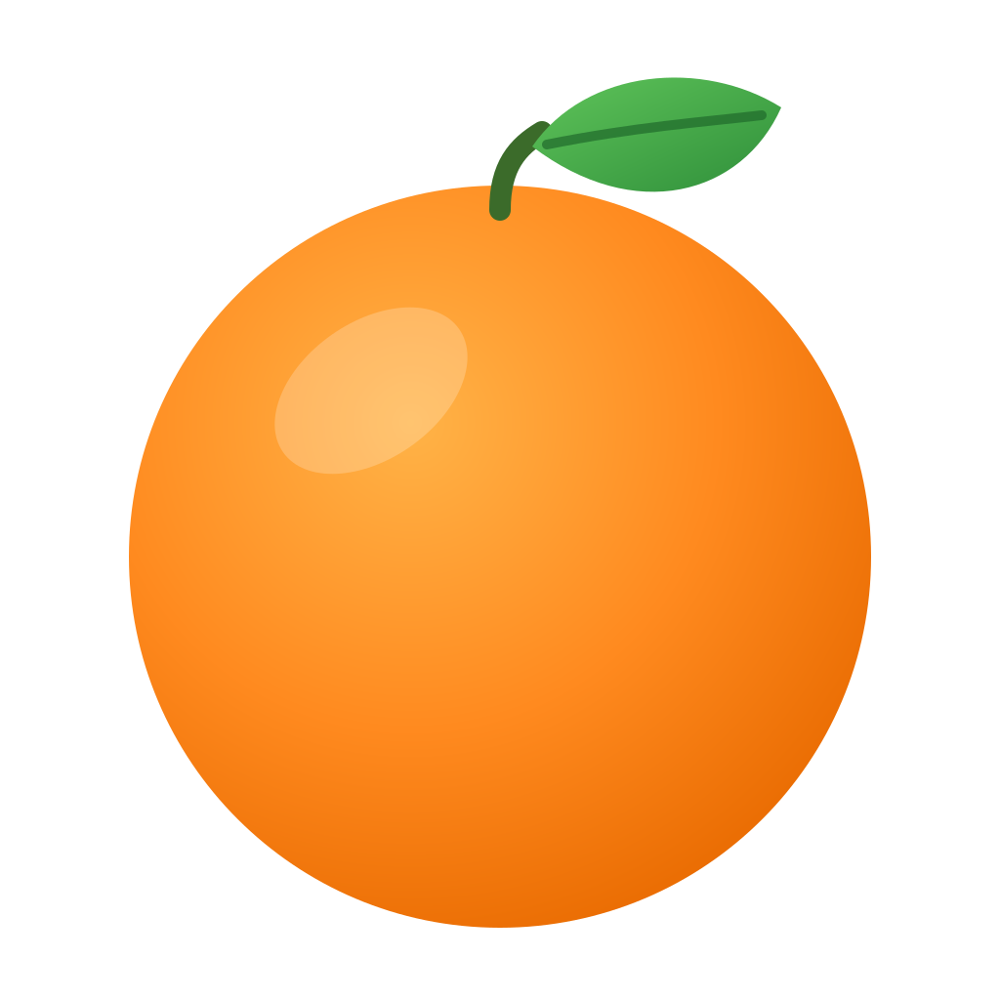
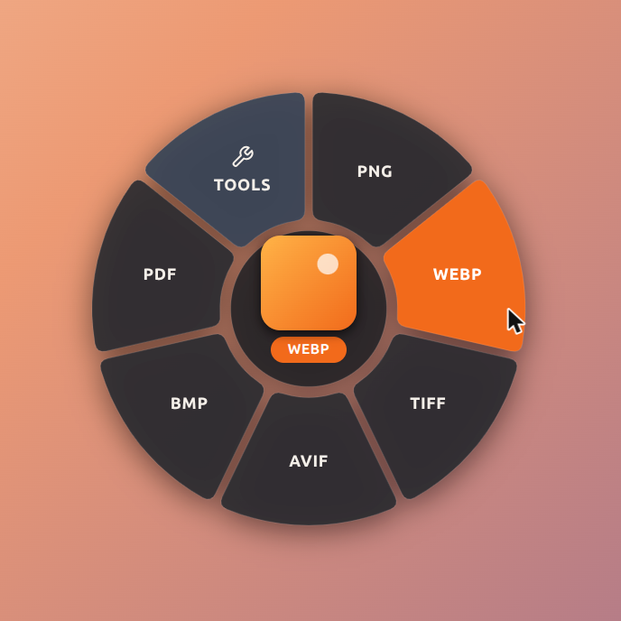
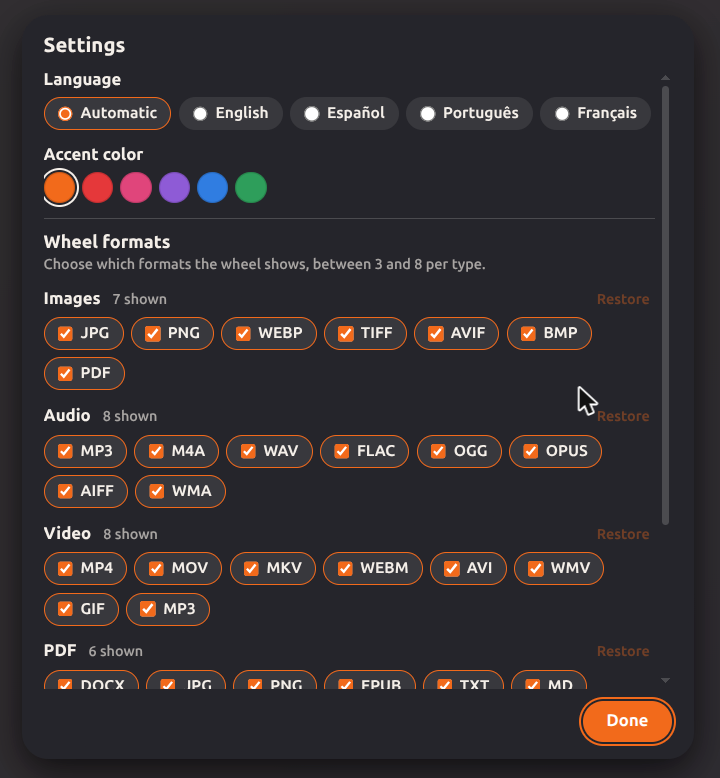

<p align="center">
  
</p>

<h1 align="center">Mandarina</h1>

<p align="center">
  A file converter for Linux with a floating radial wheel.<br>
  Everything runs on your machine; nothing is uploaded.
</p>

<p align="center">
  <a href="LICENSE"></a>
  
  
  
</p>

<p align="center">
  English | <a href="README.es.md">Español</a>
</p>

Select one or more files in Nautilus, press a shortcut or right-click, and a wheel appears next to your cursor with the formats the files can be converted to. Pick one and the conversion runs on your machine.

<p align="center">
  
</p>

> **Status: beta (version 0.1.0).** It works, and the `.deb` was tried in clean Debian and Ubuntu systems, but the app itself has only been used on a real desktop with Ubuntu and GNOME. Read [Project status](#project-status) before relying on it.

## Contents

- [Installation](#installation)
- [Usage](#usage)
- [Tools](#tools)
- [Supported formats](#supported-formats)
- [Settings](#settings)
- [Language](#language)
- [Limitations and known issues](#limitations-and-known-issues)
- [Project status](#project-status)
- [Contributing](#contributing)
- [License](#license)

## Installation

Copy and paste each block into a terminal.

### Debian, Ubuntu, Linux Mint and derivatives (recommended)

```bash
wget https://github.com/JorgeFTS/Mandarina/releases/download/v0.1.0-beta/Mandarina_0.1.0_amd64.deb
sudo apt install ./Mandarina_0.1.0_amd64.deb
```

That installs the app and the conversion tools it uses (about 600 to 700 MB on an empty system, mostly LibreOffice; much less on a normal desktop, where most of them are already installed). Then open **Mandarina** from the applications menu, or run `mandarina` and drag a file onto it.

To get the right-click entry and the **Alt+M** shortcut in **Nautilus** (GNOME, Ubuntu), run this and then restart Nautilus (`nautilus -q` closes its windows):

```bash
bash /usr/share/mandarina/install-nautilus.sh
nautilus -q
```

The installer is only run by you; it does not touch your files by itself. Other file managers (Nemo in Mint, Dolphin...) are not supported yet.

To skip the conversion tools and install them later, as the app asks, use `sudo apt install --no-install-recommends ./Mandarina_0.1.0_amd64.deb`.

The package was installed and tried in clean containers of Ubuntu 22.04, 24.04 and 26.04 and Debian 12 and 13 (see [docs/Publishing.md](docs/Publishing.md)), but not yet on every real desktop. Linux Mint was not tried.

### Other distributions (Arch, CachyOS, Fedora...): build from source

There is no package for them yet, so you build it. It should work with the equivalent packages, but that has not been checked. Install [Rust](https://rustup.rs) (1.85 or newer) and [Node.js](https://nodejs.org) with npm first. The package names below are the Debian and Ubuntu ones.

```bash
sudo apt install ffmpeg imagemagick librsvg2-bin pandoc libreoffice poppler-utils ghostscript zip unzip 7zip
sudo apt install build-essential curl wget file libwebkit2gtk-4.1-dev libxdo-dev libssl-dev libayatana-appindicator3-dev librsvg2-dev
git clone https://github.com/JorgeFTS/Mandarina.git
cd Mandarina
npm install
npm run tauri build -- --no-bundle
```

The first line installs the conversion tools (if one is missing, only the formats that use it fail, and the app tells you which package to install) and the second one the build tools. The binary is `src-tauri/target/release/mandarina`. The first build takes a few minutes (it compiles with LTO). Rebuild whenever `src/` changes, because the binary embeds the interface. For a faster, larger build use `npm run tauri build -- --debug --no-bundle` (the binary goes to `src-tauri/target/debug/`), and `npm run tauri dev` for development mode.

For the Nautilus entry and shortcut:

```bash
packaging/install-nautilus.sh src-tauri/target/release/mandarina
nautilus -q
```

The installer copies a script to `~/.local/share/nautilus/scripts/` and adds the `Alt+M` shortcut to `~/.config/nautilus/scripts-accels`. The script is named after the active language (see [Language](#language)): `Convert with Mandarina`, `Convertir con Mandarina`, `Converter com Mandarina` or `Convertir avec Mandarina`. If an entry of another language was installed before, the installer removes it so there is only one, and it can be run again at any time. For a different shortcut: `MANDARINA_ATAJO="<Control><Alt>m" packaging/install-nautilus.sh src-tauri/target/release/mandarina`.

To build your own `.deb`: `npm run tauri build -- --bundles deb` (it goes to `src-tauri/target/release/bundle/deb/`).

### Uninstall

Delete the script from `~/.local/share/nautilus/scripts/` and its line in `~/.config/nautilus/scripts-accels`. If you installed the `.deb`, run `sudo apt remove mandarina`. Your settings are in `~/.config/mandarina/`; delete that folder to remove them too.

## Usage

1. Select one or more files (or a folder) in Nautilus.
2. Press **Alt+M**, or right-click and choose **Scripts → Convert with Mandarina** (named after the language, for example **Convertir con Mandarina** in Spanish; see [Language](#language)).
3. The wheel appears next to the cursor, with one segment per target format.
4. Pick a format (click, or arrow keys and Enter). A card shows progress and can be cancelled.
5. The result is saved next to the original with a new name (`photo.png` → `photo.jpg`). Nothing is ever overwritten: if the name exists, you get `photo 2.jpg`, `photo 3.jpg`...

Escape closes the wheel. You can also run `mandarina` without arguments and drag a file onto the window.

<p align="center">
  
</p>

The conversions are done by system programs (ffmpeg, ImageMagick, pandoc, LibreOffice, poppler...), which Mandarina calls from Rust without going through a shell.

## Tools

With **a single file**, the last wheel segment is **TOOLS** and opens a second wheel:

| Type | Tools |
|---|---|
| Image | reduce size, strip metadata, crop (visual box), rotate, flip, resize |
| Video | reduce size, strip metadata, trim (frame strip), rotate, flip, resize, remove audio |
| Audio | reduce size, strip metadata, trim (waveform) |
| PDF | reduce size |
| Any other file | zip |

The result goes next to the original, in the same format and with a suffix: `photo (compressed).jpg`, and likewise `(no metadata)`, `(trimmed)`, `(rotated)`, `(flipped)`, `(resized)` and `(no audio)`. If compressing does not save at least 2 %, the app says so instead of creating a nearly identical file. Wav, flac, aiff and bmp do not offer Reduce size. Reduce size is not zipping: the ZIP tool packs any file into a `.zip`.

The trim editors (image, audio and video) include a field for the name of the new file. It starts as `photo (trimmed)`, the original extension is shown next to it, and it is checked as you type. Compressing a PDF needs ghostscript. More details in [docs/Tools.md](docs/Tools.md).

## Supported formats

| Type | Targets | Tool |
|---|---|---|
| Image | jpg, png, webp, tiff, avif, bmp, pdf | ImageMagick, rsvg-convert (SVG) |
| Audio | mp3, m4a, wav, flac, ogg, opus, aiff, wma | ffmpeg |
| Video | mp4, mov, mkv, webm, avi, wmv, gif, mp3 | ffmpeg |
| PDF | docx, jpg, png, epub, txt, md | pdftoppm, pdftotext, pandoc, LibreOffice |
| Document | docx, md, txt, epub, html, pdf, jpg, png | pandoc, LibreOffice |
| Presentation | pdf, jpg, png | LibreOffice |
| Spreadsheet | xlsx, ods, csv, tsv, pdf | LibreOffice |
| Subtitles | srt, vtt, txt | ffmpeg |
| Archive | zip, tar, tar.gz (rar as input only) | zip, tar, unzip, 7z |
| Folder | zip, tar, tar.gz | zip, tar |

HEIC is supported as input only. Some targets depend on how your ImageMagick or ffmpeg was built.

## Settings

The gear that appears at the bottom of the center circle opens the settings: the formats each wheel shows (between 3 and 8 per type), the language and the accent color.

<p align="center">
  
</p>

## Language

Mandarina is available in **English, Spanish (Español), Portuguese (Português) and French (Français)**. You can pick the language in the settings (the gear that appears at the bottom of the wheel's center circle), or leave it on **Automatic**. The change applies immediately.

In Automatic, the language is chosen once at startup from the system's environment variables, checked in this order: `MANDARINA_LANG` (see below), the language saved in the settings, `LC_ALL`, `LC_MESSAGES`, `LANGUAGE` (first language in the list) and `LANG`. If the value starts with `es`, `pt` or `fr`, the app uses that language; otherwise, or if none is set, it is in English (for example, a system in Chinese gets English).

To force a language, set `MANDARINA_LANG` to `en`, `es`, `pt` or `fr`, which takes priority over the others:

```bash
MANDARINA_LANG=fr mandarina
```

The language applies to the interface, error messages, the names of the files that the tools create (`photo (compressed).jpg` in English, `foto (comprimido).jpg` in Spanish, `foto (compressé).jpg` in French) and the Nautilus menu entry (see below). Messages from ffmpeg, ImageMagick and the other programs are passed through as they are. The Portuguese and French translations were written without a native review, so corrections are welcome (see `CONTRIBUTING.md` to add or fix a language).

## Limitations and known issues

- **Wayland:** an application cannot know the cursor position or detect drags or keys such as Shift outside its own window. For that reason the Nautilus script starts the app with `GDK_BACKEND=x11` (XWayland), and the window is placed next to the cursor in two steps. Without `GDK_BACKEND=x11` it is not placed next to the cursor.
- With **several files**, the wheel only offers the formats that all of them support (for example, 5 images give the image formats; an image and a document only `pdf`, `jpg` and `png`). Files already in that format are skipped, and if one fails the rest keep converting. Folders can be compressed. With several files of any type the wheel always offers ZIP and packs them all into a single `Archive.zip`. The tools wheel is only available with a single file.
- **Nautilus only.** No integration with other file managers.
- **GNOME 50 can prevent the app from starting.** On GNOME 50, WebKitGTK/GTK 3.24 aborts with `Settings schema 'org.gnome.settings-daemon.plugins.xsettings' does not contain a key named 'antialiasing'`, because GNOME moved those keys to a `.deprecated` schema. This is a system issue, not a Mandarina bug. Local workaround without `sudo`: copy the `xsettings` schema with the `antialiasing`, `hinting` and `rgba-order` keys added, together with `org.gnome.settings-daemon.enums.xml`, to `~/.local/share/glib-2.0/schemas/` and run `glib-compile-schemas` in that folder. Remove it once GNOME fixes it. Details in [docs/Decisions.md](docs/Decisions.md).
- **VS Code installed as a snap:** if you launch the app from its integrated terminal, it inherits snap environment variables (`GTK_PATH`, `GIO_MODULE_DIR`, `GSETTINGS_SCHEMA_DIR`...) that make WebKitGTK fail. Launch it from another terminal or clear those variables first.
- Unusual file names, permissions, and very heavy conversions (long videos, huge documents) have not been tested systematically.

## Project status

Works and tested:

- The Rust converters and tools: `cargo test` runs unit tests plus integration tests with ffmpeg, ImageMagick, pandoc, poppler, LibreOffice and ghostscript (integration tests are skipped if the tool is missing).
- By hand: md to pdf/png/docx (including Markdown tables with long separator lines, whose columns get widths that follow their content), docx to pdf, doc to md/pdf, pptx to pdf/jpg, tsv to xlsx/csv, pdf to docx/md/epub/txt, and mp4 to webm (about 1.8 times faster than the first version, same quality). A PDF to Word conversion of a CV with a colored banner keeps the text visible over it (checked in LibreOffice, not in Word).
- The `.deb`: installed, started, used to convert a photo, and removed in clean containers of Ubuntu 22.04, 24.04 and 26.04 and Debian 12 and 13, and installed on a real Ubuntu desktop.

Not verified or pending:

- The wheel in the real window: placement next to the cursor, on-screen transparency, real drag and drop, and cancel. Design screenshots only test the interface, not Tauri. A checklist for trying it is in [docs/Manual-Testing.md](docs/Manual-Testing.md).
- Untested: rar, zip extraction with 7z only, SVG, video to GIF, the "missing tool" messages, and real .xls, .ods and .odp files.
- Only used on a real desktop with Ubuntu and GNOME 50 (Wayland). No tests on pure X11, on other distributions (the `.deb` does not install on Arch, Fedora or similar) or on other desktop environments.
- The `.deb` (2.6 MB) does not install the Nautilus script by itself; you run `bash /usr/share/mandarina/install-nautilus.sh`.
- A Markdown file shows its images only if they are next to it (a missing `assets/` folder means no images in the result, and the app does not warn about it yet).
- Pending: file-action wheels, audio/video playback inside the trim editor, and tools for several files or for documents.

## Contributing

See [CONTRIBUTING.md](CONTRIBUTING.md). The technical documentation is in [docs/](docs/Home.md): one short note per module.

## License

[MIT](LICENSE). You can use, copy, modify and distribute Mandarina, as long as you keep the copyright notice.

## Acknowledgements and inspiration

Mandarina is inspired by the behavior of Tangerine for Mac (Leap Studio): a format wheel that appears next to the cursor. Mandarina is an independent project: it is not affiliated with Leap Studio or Tangerine, and it does not copy their design, icon, text or assets. All code, design and the icon are original.

Built with [Tauri](https://tauri.app), ffmpeg, ImageMagick, pandoc, LibreOffice and poppler.
